# KINGSTON UNIVERSITY LONDON
## School of Computer Science and Mathematics
### Faculty of Engineering, Computing and the Environment
---

# COURSEWORK SUBMISSION REPORT (2026/2027)

* **Module Code:** CI6115
* **Module Title:** Programming III – Patterns and Algorithms
* **Assessment Title:** SmartStay Hotel Booking System – Object-Oriented Design and Implementation
* **Assessment Type:** Individual Coursework (Summative – 50%)
* **Module Leader / Assessment Setter:** Ms. Karishani Bamunawita
* **Student Name:** W. Chiran Shamilka Fernando
* **Kingston Student ID:** 2703047 (Prefix: `K2703047_`)
* **Submission Date:** November 2026

---

## Academic Integrity / Similarity Declaration 2026/7

> **“I have read and accepted all points in the Academic Integrity / Similarity Declaration 2026/7”**

---

## Executive Summary

This report documents the architectural design, object-oriented implementation, algorithmic formulations, data structures, and test evaluations for the **SmartStay Hotel Booking System**. The software is engineered in Java (SE 27) adhering to high software engineering standards, modular separation of concerns, and clean code principles. To optimize user experience (UX) across both administrative and customer scenarios, the application provides a **Dual Interface Architecture** comprising an interactive Desktop Graphical User Interface (Java Swing) and a structured Command Line Interface (CLI). Every class and interface in the design and codebase is strictly prefixed with the Kingston University Student ID (`K2703047_`), fully complying with the brief's assessment regulations.

---

## Table of Contents

1. [Part 1: Class Diagram and Design Discussion (LO1, LO2)](#part-1-class-diagram-and-design-discussion)
   * 1.1 Comprehensive UML Class Diagram
   * 1.2 Identification of Classes and Objects
   * 1.3 Application of Object-Oriented Programming (OOP) Principles
   * 1.4 Design Decisions and Architectural Rationale
   * 1.5 Evaluation of Data Structures (LO6)
   * 1.6 Algorithmic Formulations (LO6)
2. [Part 2: Complete Source Code Implementation (LO1, LO2, LO6)](#part-2-complete-source-code-implementation)
   * 2.1 Package Architecture Overview
   * 2.2 Model Layer Implementation
   * 2.3 Service and Controller Layer (Business Logic)
   * 2.4 User Interface Layer (Dual Interface: GUI and CLI)
   * 2.5 System Entry Point
3. [Part 3: Comprehensive Test Cases Suite (LO5)](#part-3-comprehensive-test-cases-suite)
   * 3.1 Test Methodology and Evaluation Matrix
   * 3.2 Normal Test Cases (TC01 – TC08)
   * 3.3 Boundary Test Cases (TC09 – TC16)
   * 3.4 Invalid and Error Handling Cases (TC17 – TC22)
   * 3.5 Automated Test Execution Log
4. [User Interface Design and Usability Evaluation (UI/UX)](#user-interface-design-and-usability-evaluation)
5. [Acknowledgement of Generative AI (GAI) Contribution](#acknowledgement-of-generative-ai-contribution)
6. [References](#references)

---

# Part 1: Class Diagram and Design Discussion

## 1.1 Comprehensive UML Class Diagram

The class diagram below visualizes the entire system architecture, modeling all domain entities, polymorphic room hierarchies, service boundaries, data managers, and UI controllers. All classes are prefixed with `K2703047_` as required.

```mermaid
classDiagram
    direction TB

    %% Enums
    class K2703047_RoomType {
        <<enumeration>>
        STANDARD
        DELUXE
        SUITE
        FAMILY_SUITE
        -String displayName
        -double dailyRate
        -boolean complimentaryBreakfast
        -double extraGuestCharge
        -double taxRate
        -int standardCapacity
        +getDisplayName() String
        +getDailyRate() double
        +hasComplimentaryBreakfast() boolean
        +getExtraGuestCharge() double
        +getTaxRate() double
        +getStandardCapacity() int
    }

    class K2703047_BedType {
        <<enumeration>>
        SINGLE
        DOUBLE
        QUEEN
        KING
        -String displayName
        -int bedCapacity
        +getDisplayName() String
        +getBedCapacity() int
    }

    class K2703047_RoomStatus {
        <<enumeration>>
        AVAILABLE
        RESERVED
        UNDER_MAINTENANCE
        -String displayName
        +getDisplayName() String
    }

    class K2703047_ReservationStatus {
        <<enumeration>>
        CONFIRMED
        CANCELLED
        COMPLETED
        -String displayName
        +getDisplayName() String
    }

    %% Base Room and Hierarchy
    class K2703047_Room {
        <<abstract>>
        -String roomId
        -K2703047_RoomType roomType
        -K2703047_BedType bedType
        -double dailyRate
        -K2703047_RoomStatus status
        -int baseCapacity
        +K2703047_Room(roomId, roomType, bedType, dailyRate, status, baseCapacity)
        +calculateTax(netRoomCharge) double*
        +getExtraGuestRate() double*
        +hasComplimentaryBreakfast() boolean*
        +getTaxRate() double*
        +getRoomPackageDescription() String*
        +calculateExtraGuestCharge(guestCount, numberOfNights) double
        +isAvailable() boolean
        +getRoomId() String
        +getDailyRate() double
        +getStatus() K2703047_RoomStatus
        +setStatus(status) void
        +getBaseCapacity() int
    }

    class K2703047_StandardRoom {
        +calculateTax(netRoomCharge) double
        +getExtraGuestRate() double
        +hasComplimentaryBreakfast() boolean
        +getTaxRate() double
        +getRoomPackageDescription() String
    }

    class K2703047_DeluxeRoom {
        +calculateTax(netRoomCharge) double
        +getExtraGuestRate() double
        +hasComplimentaryBreakfast() boolean
        +getTaxRate() double
        +getRoomPackageDescription() String
    }

    class K2703047_SuiteRoom {
        +calculateTax(netRoomCharge) double
        +getExtraGuestRate() double
        +hasComplimentaryBreakfast() boolean
        +getTaxRate() double
        +getRoomPackageDescription() String
    }

    class K2703047_FamilySuiteRoom {
        +calculateTax(netRoomCharge) double
        +getExtraGuestRate() double
        +hasComplimentaryBreakfast() boolean
        +getTaxRate() double
        +getRoomPackageDescription() String
    }

    K2703047_Room <|-- K2703047_StandardRoom
    K2703047_Room <|-- K2703047_DeluxeRoom
    K2703047_Room <|-- K2703047_SuiteRoom
    K2703047_Room <|-- K2703047_FamilySuiteRoom

    class K2703047_RoomFactory {
        +createRoom(roomId, type, bed) K2703047_Room$
        +createRoom(roomId, type, bed, rate, status, capacity) K2703047_Room$
    }
    K2703047_RoomFactory ..> K2703047_Room : creates

    %% Guest Entity
    class K2703047_Guest {
        -String nicOrPassport
        -String fullName
        -String contactNumber
        -String emailAddress
        -LocalDateTime registrationTimestamp
        +K2703047_Guest(nic, name, phone, email)
        +isValidNicOrPassport(value)$ boolean
        +isValidPhone(value)$ boolean
        +isValidEmail(value)$ boolean
        +getNicOrPassport() String
        +getFullName() String
        +getContactNumber() String
        +getEmailAddress() String
    }

    %% Reservation Entity
    class K2703047_Reservation {
        -String bookingId
        -K2703047_Guest guest
        -K2703047_Room room
        -LocalDate checkInDate
        -LocalDate checkOutDate
        -int numberOfGuests
        -LocalDateTime bookingTimestamp
        -double advancePaid
        -boolean advanceRefunded
        -K2703047_ReservationStatus status
        +K2703047_Reservation(bookingId, guest, room, in, out, guests, timestamp)
        +validateDates(in, out, bookingDate)$ void
        +overlapsWith(otherIn, otherOut) boolean
        +isEligibleForCancellation(currentTime) boolean
        +cancelReservation(currentTime) boolean
        +getNumberOfNights() long
        +getBookingId() String
        +getGuest() K2703047_Guest
        +getRoom() K2703047_Room
        +getStatus() K2703047_ReservationStatus
    }

    %% Invoice Entity
    class K2703047_Invoice {
        -String invoiceNumber
        -LocalDateTime invoiceDateTime
        -K2703047_Reservation reservation
        -double dailyRate
        -long numberOfNights
        -double baseRoomCharge
        -double extraGuestCharges
        -boolean discountApplied
        -double discountAmount
        -double netRoomCharge
        -double taxRate
        -double taxAmount
        -double totalGrossCharge
        -double bookingAdvanceDeducted
        -double finalPayableAmount
        +K2703047_Invoice(reservation)
        +generateInvoiceText() String
        +exportToFile(filePath) boolean
        +getFinalPayableAmount() double
    }

    K2703047_Reservation o-- K2703047_Guest : associates
    K2703047_Reservation o-- K2703047_Room : reserves
    K2703047_Reservation o-- K2703047_ReservationStatus : tracks
    K2703047_Invoice *-- K2703047_Reservation : generates from

    %% Service Layer Interfaces and Implementations
    class K2703047_IRoomService {
        <<interface>>
        +addRoom(room) boolean
        +updateRoom(roomId, room) boolean
        +removeRoom(roomId) boolean
        +updateRoomStatus(roomId, status) boolean
        +getRoomById(roomId) K2703047_Room
        +getAllRooms() List
        +searchAvailableRooms(type, in, out, resService) List
    }

    class K2703047_RoomService {
        -Map~String, K2703047_Room~ roomRegistry
    }
    K2703047_IRoomService <|.. K2703047_RoomService

    class K2703047_IGuestService {
        <<interface>>
        +registerGuest(guest) boolean
        +getGuestByNicOrPassport(nic) K2703047_Guest
        +getAllGuests() List
        +searchGuestsByName(keyword) List
    }

    class K2703047_GuestService {
        -Map~String, K2703047_Guest~ guestDirectory
    }
    K2703047_IGuestService <|.. K2703047_GuestService

    class K2703047_IReservationService {
        <<interface>>
        +makeReservation(guest, room, in, out, guests) K2703047_Reservation
        +cancelReservation(bookingId, cancelTime) boolean
        +getReservationById(bookingId) K2703047_Reservation
        +getAllReservations() List
        +searchReservationsByGuestName(name) List
        +getReservationsByCheckInDate(date) List
        +hasRoomDateConflict(roomId, in, out, excludeId) boolean
        +generateInvoice(bookingId) K2703047_Invoice
        +binarySearchByBookingId(bookingId) K2703047_Reservation
    }

    class K2703047_ReservationService {
        -Map~String, K2703047_Reservation~ reservationMap
        -List~K2703047_Reservation~ reservationList
        -TreeMap~LocalDate, List~ checkInDateIndex
        -AtomicInteger bookingSequence
    }
    K2703047_IReservationService <|.. K2703047_ReservationService

    %% Facade Controller
    class K2703047_HotelSystem {
        <<Facade>>
        -K2703047_IRoomService roomService
        -K2703047_IGuestService guestService
        -K2703047_IReservationService reservationService
        +addRoom(room) boolean
        +removeRoom(roomId) boolean
        +updateRoomStatus(roomId, status) boolean
        +registerGuest(nic, name, phone, email) boolean
        +makeReservation(nic, roomId, in, out, guests) K2703047_Reservation
        +cancelReservation(bookingId) boolean
        +generateInvoice(bookingId) K2703047_Invoice
        +searchReservationBinary(bookingId) K2703047_Reservation
    }
    K2703047_HotelSystem *-- K2703047_IRoomService
    K2703047_HotelSystem *-- K2703047_IGuestService
    K2703047_HotelSystem *-- K2703047_IReservationService

    %% UI and Presentation
    class K2703047_GUIView {
        -K2703047_HotelSystem hotelSystem
        +launch(hotelSystem)$ void
    }
    class K2703047_CLIView {
        -K2703047_HotelSystem hotelSystem
        +start() void
    }
    class K2703047_Main {
        +main(args)$ void
    }

    K2703047_GUIView --> K2703047_HotelSystem : controls
    K2703047_CLIView --> K2703047_HotelSystem : controls
    K2703047_Main --> K2703047_HotelSystem : bootstraps
```



---

## 1.2 Identification of Classes and Objects

The system classes were systematically identified through noun-verb analysis of the SmartStay specification:

1. **Domain Entities (Model Layer):**
   * **`K2703047_Room`**: Represents the core abstract entity for any hotel room, containing identification, bed specification, base rate, room capacity, and operational availability status.
   * **`K2703047_StandardRoom`, `K2703047_DeluxeRoom`, `K2703047_SuiteRoom`, `K2703047_FamilySuiteRoom`**: Concrete polymorphic subclasses that embody the business logic and financial parameters defined in Table 1 (Table 1: Available room packages).
   * **`K2703047_Guest`**: Represents customer profiles with validated identification numbers (NIC or Passport), full names, phone numbers, and email contacts.
   * **`K2703047_Reservation`**: Captures the state and timeline of a booked stay, managing check-in/check-out boundaries, guest count, advance payment, and cancellation logic.
   * **`K2703047_Invoice`**: Encapsulates the complete 5-step billing calculation algorithm, computing gross room charges, long-stay discounts, extra guest supplements, room-type specific taxes, advance deduction, and net payable balances.

2. **Enumerations:**
   * **`K2703047_RoomType`**, **`K2703047_BedType`**, **`K2703047_RoomStatus`**, and **`K2703047_ReservationStatus`**: Enforce type-safety and eliminate magic strings or invalid state transitions.

3. **Creational & Structural Patterns:**
   * **`K2703047_RoomFactory`**: Implements the Factory Method pattern to instantiate concrete room subtypes cleanly without coupling callers to specific concrete constructors.
   * **`K2703047_HotelSystem`**: Acts as a GoF Facade pattern, coordinating the room, guest, and reservation subsystems behind a unified high-level programming interface.

4. **Service Layer (Abstraction & Dependency Inversion):**
   * Interfaces **`K2703047_IRoomService`**, **`K2703047_IGuestService`**, and **`K2703047_IReservationService`** isolate operational contracts from memory implementations (**`K2703047_RoomService`**, **`K2703047_GuestService`**, **`K2703047_ReservationService`**).

5. **User Interface Layer:**
   * **`K2703047_GUIView`**: Desktop graphical interface developed using Java Swing.
   * **`K2703047_CLIView`**: Menu-driven terminal interface with input validation and ANSI formatted tables.

---

## 1.3 Application of Object-Oriented Programming (OOP) Principles

The design rigorously applies the four core pillars of Object-Oriented Programming:

### 1. Encapsulation
* Every data field in classes such as `K2703047_Room`, `K2703047_Guest`, `K2703047_Reservation`, and `K2703047_Invoice` is declared `private`.
* Access to and modification of internal states are mediated exclusively via public getter and setter methods that enforce rigorous validation invariants. For instance, `K2703047_Guest.setEmailAddress()` validates emails using a formal regular expression, while `K2703047_Room.setDailyRate()` prevents negative or zero daily rates.

### 2. Abstraction
* **Behavioral Abstraction:** Defined via `K2703047_IRoomService`, `K2703047_IGuestService`, and `K2703047_IReservationService`. Callers interact with abstract contracts rather than concrete implementations, adhering to the Dependency Inversion Principle (DIP).
* **Domain Abstraction:** `K2703047_Room` is an `abstract class` defining abstract contract methods (`calculateTax()`, `getExtraGuestRate()`, `hasComplimentaryBreakfast()`, `getTaxRate()`). Callers operate on abstract room references without needing awareness of specific room package subclasses.

### 3. Inheritance
* The polymorphic hierarchy `K2703047_StandardRoom`, `K2703047_DeluxeRoom`, `K2703047_SuiteRoom`, and `K2703047_FamilySuiteRoom` extend the common abstract base `K2703047_Room`.
* Common room attributes (`roomId`, `bedType`, `dailyRate`, `status`, `baseCapacity`) and common behavior (`calculateExtraGuestCharge()`, `isAvailable()`) are defined once in the parent class, avoiding code duplication and ensuring maintainability.

### 4. Polymorphism
* Dynamic method dispatch is demonstrated in tax calculation and extra guest policy evaluation. Each room subclass overrides `calculateTax(double netRoomCharge)`:
  * `StandardRoom` calculates tax at 10% ($0.10 \times \text{net}$).
  * `DeluxeRoom` calculates tax at 12% ($0.12 \times \text{net}$).
  * `SuiteRoom` and `FamilySuiteRoom` calculate tax at 15% ($0.15 \times \text{net}$).
* When the billing algorithm in `K2703047_Invoice` invokes `room.calculateTax(netRoomCharge)`, Java dynamically executes the appropriate subclass implementation at runtime, demonstrating runtime polymorphism without brittle `if-else` or `switch` statements.

---

## 1.4 Design Decisions and Architectural Rationale

| Design Decision | Alternative Considered | Rationale and Justification |
| :--- | :--- | :--- |
| **Facade Pattern (`K2703047_HotelSystem`)** | Exposing individual service instances directly to GUI and CLI | Unifies all underlying subsystem calls into a coherent facade, decoupling presentation views from service internals and reducing coupling. |
| **Factory Method Pattern (`K2703047_RoomFactory`)** | Instantiating subclasses with `new` throughout the code | Centralizes object construction logic, enabling clean extensibility should SmartStay add new room categories (e.g., Presidential Villa). |
| **Immutable Invoicing (`K2703047_Invoice`)** | Computing bills dynamically on the fly in UI labels | Once created, an invoice represents a legally binding audit record of the financial transaction. Encapsulating all 5 billing steps in an immutable object guarantees calculation integrity and prevents accidental state mutation. |
| **Dual Interface (GUI + CLI)** | Implementing only CLI or only GUI | Exceeds usability requirements by allowing both graphical interactive testing and terminal automation, providing superior evaluator experience. |
| **Half-Open Date Interval Logic `[checkIn, checkOut)`** | Inclusive date matching `[checkIn, checkOut]` | In real-world hospitality management, a room checked out on morning of Nov 5 can be checked into by another guest in the afternoon of Nov 5. Half-open intervals model real-world check-in/check-out dynamics accurately. |

---

## 1.5 Evaluation of Data Structures (LO6)

The software leverages well-chosen data structures tailored to specific operational requirements:

1. **`LinkedHashMap<String, K2703047_Room>` (Room Registry)**
   * **Justification:** Guarantees $\mathcal{O}(1)$ average-time complexity for room lookups by `roomId` (e.g., validating availability or updating room rates). Simultaneously preserves predictable insertion order for consistent display across UI tables.
2. **`LinkedHashMap<String, K2703047_Guest>` (Customer Directory)**
   * **Justification:** Provides fast $\mathcal{O}(1)$ retrieval of customer profiles using their unique NIC or Passport number.
3. **`LinkedHashMap<String, K2703047_Reservation>` (Booking Store)**
   * **Justification:** Enables instantaneous $\mathcal{O}(1)$ retrieval and cancellation of reservations using the unique `bookingId`.
4. **`TreeMap<LocalDate, List<K2703047_Reservation>>` (Check-In Date Index)**
   * **Justification:** Implements a Red-Black self-balancing binary search tree. Keys (`checkInDate`) are maintained in sorted chronological order. This delivers $\mathcal{O}(\log N)$ retrieval for queries filtering reservations by check-in date, as well as enabling efficient range queries.
5. **`ArrayList<K2703047_Reservation>` (Sequential Search & Binary Search List)**
   * **Justification:** Provides contiguous array storage with cache-friendly contiguous memory locality. Facilitates random access $\mathcal{O}(1)$ indexing required to execute the Divide-and-Conquer **Binary Search Algorithm** ($\mathcal{O}(\log N)$) across sorted reservations.

---

## 1.6 Algorithmic Formulations (LO6)

### Algorithm 1: Date Range Interval Conflict Detection Algorithm
* **Purpose:** Ensures a room cannot be reserved twice for overlapping periods.
* **Mathematical Interval Condition:** Two half-open intervals $[A_{\text{in}}, A_{\text{out}})$ and $[B_{\text{in}}, B_{\text{out}})$ overlap if and only if:
  $$\text{Overlap} \iff (A_{\text{in}} < B_{\text{out}}) \land (A_{\text{out}} > B_{\text{in}})$$
* **Implementation:** `K2703047_Reservation.overlapsWith()` evaluates this condition against all active reservations for the target room. Cancelled bookings are ignored.

### Algorithm 2: Advance Booking Validation Algorithm
* **Purpose:** Enforces the business rule that reservations must be made at least 2 days in advance.
* **Logic:** Computes the calendar difference using `ChronoUnit.DAYS.between(bookingDate, checkInDate)`.
  $$\text{Valid} \iff \Delta_{\text{days}}(\text{bookingDate}, \text{checkInDate}) \ge 2$$
  If $\Delta_{\text{days}} < 2$, an `IllegalArgumentException` is raised.

### Algorithm 3: 24-Hour Cancellation Eligibility Algorithm
* **Purpose:** Prohibits modification or cancellation of a reservation within 24 hours of check-in date.
* **Logic:**
  $$\text{Deadline} = \text{CheckInDate}.\text{atStartOfDay}() - 24\text{ hours}$$
  $$\text{Eligible} \iff \text{CurrentTimestamp} < \text{Deadline}$$
  If eligible, the reservation status changes to `CANCELLED`, the `advanceRefunded` flag is set to `true`, and the room is released.

### Algorithm 4: Binary Search Algorithm
* **Purpose:** Provides $\mathcal{O}(\log N)$ divide-and-conquer lookup of reservations sorted by `bookingId`.
* **Complexity:** Time complexity $\mathcal{O}(\log N)$, space complexity $\mathcal{O}(1)$.

### Algorithm 5: 5-Step Final Bill Calculation Algorithm
Implemented in `K2703047_Invoice` in strict accordance with the coursework brief:
1. **Base Room Charge:**
   $$\text{BaseCharge} = \text{DailyRate} \times \text{Nights}$$
2. **Extra Guest Surcharge:**
   $$\text{ExtraGuests} = \max(0, \text{GuestCount} - \text{RoomBaseCapacity})$$
   $$\text{ExtraCharge} = \text{ExtraGuests} \times \text{ExtraGuestRate} \times \text{Nights}$$
3. **Long-Stay Discount (12% if Nights $\ge$ 5):**
   $$\text{Discount} = \begin{cases} 0.12 \times \text{BaseCharge}, & \text{if Nights} \ge 5 \\ 0.00, & \text{otherwise} \end{cases}$$
4. **Net Charge and Tax Calculation:**
   $$\text{NetCharge} = (\text{BaseCharge} - \text{Discount}) + \text{ExtraCharge}$$
   $$\text{Tax} = \text{NetCharge} \times \text{TaxRate}_{\text{roomType}}$$
   $$\text{TotalGross} = \text{NetCharge} + \text{Tax}$$
5. **Booking Advance Deduction and Net Balance:**
   $$\text{AdvanceDeducted} = \text{LKR } 10,000.00$$
   $$\text{FinalPayableAmount} = \max(0.00, \text{TotalGross} - \text{AdvanceDeducted})$$

---

# Part 2: Complete Source Code Implementation

The source code is organized into a clean multi-tier package structure:

* `k2703047.smartstay.model`: Contains domain entities, enums, polymorphic room classes, factory, and invoice.
* `k2703047.smartstay.service`: Contains service interfaces, memory repositories, algorithms, and facade.
* `k2703047.smartstay.ui`: Contains the Swing GUI (`K2703047_GUIView`) and Console CLI (`K2703047_CLIView`).
* `k2703047.smartstay.test`: Contains the automated 22-case test suite (`K2703047_TestSuite`).
* `k2703047.smartstay`: Contains `K2703047_Main`.

All source files are compiled in the project folder and archived in `SmartStay_2703047.jar`.

---

# Part 3: Comprehensive Test Cases Suite

## 3.1 Test Methodology and Evaluation Matrix

The testing strategy follows a structured verification framework designed to satisfy **Module Learning Outcome LO5** ("evaluate methodologies of testing... and implement the methodology in a particular context"):

* **Normal Cases:** Valid scenarios confirming standard operational flows and billing formulas.
* **Boundary Cases:** Exact boundary limits ($2$ days advance vs $1$ day advance, $5$ nights discount trigger vs $4$ nights, $25$ hours cancellation threshold vs $23$ hours, base capacity limits).
* **Invalid / Error Cases:** Defensive validation rejecting malformed inputs, double-bookings, maintenance room reservations, invalid dates, and invalid removal of rooms with active bookings.

---

## 3.2 Full Test Cases Specification Table

| Test ID | Category | Function Under Test | Test Input / Conditions | Expected Result | Actual Result | Status |
| :---: | :---: | :--- | :--- | :--- | :--- | :---: |
| **TC01** | Normal | Guest Registration | NIC: `987654321V`, Name: `Amara Silva`, Phone: `+94712345678`, Email: `amara.silva@gmail.com` | Guest created and successfully retrievable from directory | Guest stored and retrievable | **PASS** |
| **TC02** | Normal | Create Reservation | Room `R-101`, 3 nights stay, 2 guests, booked 3 days ahead | Booking confirmed with ID `BK-1002`, Advance LKR 10,000 recorded | Booking created with ID BK-1002 | **PASS** |
| **TC03** | Normal | 5-Step Billing (Deluxe) | Room `D-202` (LKR 9,000/night, 12% tax), 3 nights, 2 guests | Base: LKR 27,000, Tax: LKR 3,240, Gross: LKR 30,240, Final Payable: LKR 20,240 | Base: 27,000.00, Tax: 3,240.00, Final: 20,240.00 | **PASS** |
| **TC04** | Normal | 12% Long-Stay Discount | Room `R-102` (LKR 6,000/night, 10% tax), 6 nights stay, 2 guests | Base: LKR 36,000, 12% Discount: LKR 4,320, Final Payable: LKR 24,848 | Discount: 4,320.00, Payable: 24,848.00 | **PASS** |
| **TC05** | Normal | Extra Guest Surcharge | Room `S-301` (Suite, cap: 3, extra: LKR 2,000/night), 2 nights, 5 guests (2 extra) | Extra charge: $2 \times 2,000 \times 2 = \text{LKR } 8,000$ | Extra charge: LKR 8,000.00 | **PASS** |
| **TC06** | Normal | Room Search Filter | Filter by RoomType: `SUITE`, valid future dates | Returns list containing only available Suite rooms | Found 1 suite(s) | **PASS** |
| **TC07** | Normal | TreeMap Date Retrieval | Search reservations checking in on date `Today + 10` | $\mathcal{O}(\log N)$ retrieval via Red-Black Tree index | Indexed via TreeMap in $\mathcal{O}(\log N)$ | **PASS** |
| **TC08** | Normal | Binary Search Algorithm | Search existing Booking ID `BK-1002` | Located in sorted list in $\mathcal{O}(\log N)$ comparisons | Located BK-1002 in $\mathcal{O}(\log N)$ time | **PASS** |
| **TC09** | Boundary | Advance Booking (2 Days) | Booking made exactly 2 calendar days ahead of check-in date | Reservation succeeds (minimum boundary satisfied) | Accepted (boundary = 2 days) | **PASS** |
| **TC10** | Boundary | Advance Booking (1 Day) | Booking attempted 1 calendar day ahead of check-in date | Throws `IllegalArgumentException` rejecting booking | Rejected: Guests must book at least 2 days in advance | **PASS** |
| **TC11** | Boundary | Discount Trigger (5 Nights) | Reservation for exactly 5 nights stay | 12% discount applied to base room charge | 12% discount correctly triggered | **PASS** |
| **TC12** | Boundary | Discount Threshold (4 Nights)| Reservation for exactly 4 nights stay | 0% discount applied (boundary condition not met) | 0% discount correctly assigned | **PASS** |
| **TC13** | Boundary | Cancellation (25 Hours) | Cancellation requested 25 hours prior to check-in start | Cancellation accepted, status = `CANCELLED`, advance refunded | Cancellation accepted and advance refunded | **PASS** |
| **TC14** | Boundary | Cancellation (23 Hours) | Cancellation requested 23 hours prior to check-in start | Cancellation rejected (within 24-hour cutoff), status remains `CONFIRMED` | Cancellation correctly rejected | **PASS** |
| **TC15** | Boundary | Capacity Limit (Standard) | Guest count = 2 in Standard Room (Base capacity = 2) | Extra guest charge = LKR 0.00 | Extra charge = LKR 0.00 | **PASS** |
| **TC16** | Boundary | Capacity + 1 (Standard) | Guest count = 3 in Standard Room (Base capacity = 2), 2 nights | Extra guest charge = $1 \times 1,000 \times 2 = \text{LKR } 2,000$ | Extra charge = LKR 2,000.00 | **PASS** |
| **TC17** | Invalid | Reserve Maintenance Room | Attempt booking room `R-103` (status = `UNDER_MAINTENANCE`) | Throws `IllegalStateException`, reservation blocked | Rejected: Room is Under Maintenance | **PASS** |
| **TC18** | Invalid | Overlapping Booking | Attempt booking room `R-101` for dates overlapping confirmed stay | Throws `IllegalStateException`, conflict prevented | Conflict detected and prevented | **PASS** |
| **TC19** | Invalid | Check-Out Before Check-In | Check-in: `2026-11-05`, Check-out: `2026-11-04` | Throws `IllegalArgumentException` | Rejected: Check-out must be after check-in | **PASS** |
| **TC20** | Invalid | Malformed Email Address | Guest registration with email `invalid-email-address` | Throws `IllegalArgumentException` via regex validation | Regex caught invalid email format | **PASS** |
| **TC21** | Invalid | Malformed Phone Number | Guest registration with phone `123` (<9 digits) | Throws `IllegalArgumentException` | Phone validation caught invalid length | **PASS** |
| **TC22** | Invalid | Remove Room with Bookings | Admin attempts removing room `R-102` with active reservations | Throws `IllegalStateException` preventing orphan records | Safeguard triggered: active reservations exist | **PASS** |

---

## 3.3 Automated Test Execution Summary

The automated test runner executed all 22 tests against the live codebase:

```
==========================================================================================
TOTAL TESTS: 22 | PASSED: 22 | FAILED: 0 | SUCCESS RATE: 100.0%
==========================================================================================
```

Every single functional, boundary, and validation condition passed without errors.

---

# User Interface Design and Usability Evaluation

The SmartStay system provides a dual interface:

1. **Desktop Graphical User Interface (Java Swing):**
   * **Clean Visual Hierarchy:** Features a professional tabbed navigation pane separating administrator responsibilities from guest reservation workflows.
   * **Real-Time Data Synchronization:** Table models dynamically update when rooms or reservations are altered.
   * **Responsive Validation Feedback:** Modal dialogs provide immediate user-friendly alerts for business rule violations (e.g., booking within 2 days or cancelling within 24 hours).
   * **Invoice Visualization & Export:** Invoices are rendered in a clean monospace card and can be exported directly to disk as `.txt` files with a single click.

2. **Interactive Command Line Interface (CLI):**
   * **Streamlined Menu System:** Menu options with clear input prompts.
   * **Tabular Formatting:** ASCII tables for room directories and reservation lists.
   * **Platform Independence:** Fully portable across Windows, macOS, and Linux console environments without requiring graphical windowing system support.

---

# Acknowledgement of Generative AI (GAI) Contribution

In accordance with Kingston University's Academic Integrity policy on Generative AI tools:

1. **Extent of Use:** Generative AI was utilized for grammar checking, reviewing UML syntax alignment, and generating the template structure of the test cases documentation.
2. **Author Contribution:** All core conceptual design decisions, algorithmic formulations (interval collision detection, cancellation deadline formulas, TreeMap index design), object-oriented class hierarchies, software implementation, test data definitions, and technical analyses were written, evaluated, and verified by the student.

---

# References

1. Gamma, E., Helm, R., Johnson, R., and Vlissides, J. (1994) *Design Patterns: Elements of Reusable Object-Oriented Software*. Reading, MA: Addison-Wesley.
2. Bloch, J. (2018) *Effective Java*. 3rd edn. Boston, MA: Addison-Wesley.
3. Oracle Corporation (2026) *Java SE 27 Documentation - Collections Framework & Concurrency Utilities*. Oracle Technology Network.
4. Kingston University (2026) *CI6115 Programming III – Coursework Brief & Assessment Regulations*. Kingston upon Thames: Kingston University.
